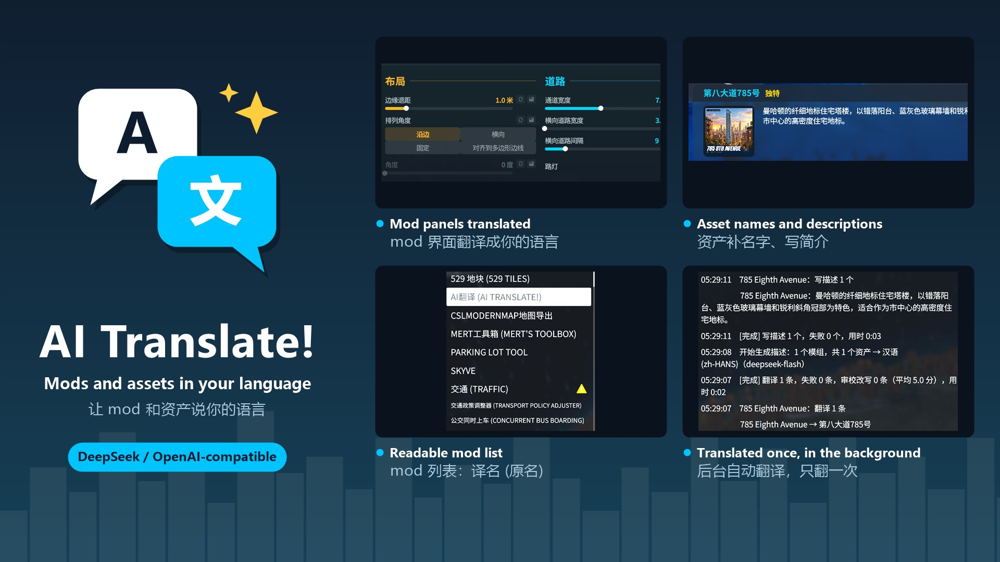

# AI Translate!

**Cities: Skylines II mod — translates your mods and assets into your game language with AI.**
**城市：天际线2 mod —— 用 AI 把 mod 和资产翻译成你的游戏语言。**

[Paradox Mods](https://mods.paradoxplaza.com/mods/162792/Windows) · by **MeroT** · GPL-3.0



---

## English

AI Translate! finds every bit of mod text that isn't in your game language yet (settings pages, tool panels, tooltips, asset names and descriptions) and translates it with DeepSeek or any OpenAI-compatible API. Each line is translated once, saved as an [I18N Everywhere](https://mods.paradoxplaza.com/mods/75426/Windows) language pack, and shows up in the game right away.

- Follows the game language; the source text can be in any language.
- Existing translations always win: text shipped by the mod author, official game text and I18N Everywhere's community translations are never overwritten.
- New or updated mods are translated in the background.
- Uses the game's own terms and building-name format, and validates placeholders (`{0}`, `%s`, `<b>`) so a translation can never break the UI. Optional AI review.
- Writes descriptions for assets that have none and names assets that only have a random ID.
- Patches official/bundled translations that left English words behind (only if the change really removes English).
- Scanning is time-sliced and runs in the background, so the game doesn't freeze.
- The settings page itself comes in all 12 game languages; other languages are translated automatically once an API key is set.
- Optional: the DLC and creator packs you own, and roads made with Road Builder, can be included too (off by default).

Some mods and asset packs only load their text once a city is open. If a mod isn't translated, load a save, click *Rescan* on the Advanced tab and translate again.

Simplified Chinese is the most tested language. Other languages use the same pipeline but have seen less real use, so feedback is very welcome.

**Install:** subscribe on [Paradox Mods](https://mods.paradoxplaza.com/mods/162792/Windows), then open *Options → AI Translate! → Settings*, enter your API key and click *Test connection*.

## 中文

AI Translate! 会找出 mod 里还不是你游戏语言的文字（设置页、工具面板、提示、资产名称和描述），用 DeepSeek 或任何兼容 OpenAI 的接口翻译。每句只翻一次，存成 [I18N Everywhere](https://mods.paradoxplaza.com/mods/75426/Windows) 语言包，马上在游戏里生效。

- 跟随游戏语言，原文是什么语言都可以。
- 已有翻译永远优先：mod 自带的、游戏官方的、I18N Everywhere 社区翻好的都不会被覆盖。
- 新装或更新的 mod 在后台自动翻译。
- 沿用游戏自己的术语和建筑命名格式，校验 `{0}`、`%s`、`<b>` 等占位符，不会把界面弄坏；可选 AI 审校。
- 给没有描述的资产写简介，给只有随机编号的资产起名。
- 修正官方或自带译文里漏翻的英文（只采用真正减少了英文的改写）。
- 检测分帧、放在后台进行，不卡游戏。
- 设置页本身预置游戏的全部 12 种语言；其他语言填好 API Key 后自动翻译。
- 可选：你拥有的 DLC 和创作者包、Road Builder 建的道路也能加入翻译范围（默认关闭）。

有些 mod 和资产包要进入存档后才加载文本。如果某个 mod 没被翻译，请进入存档，到「高级」页点「重新检测」，再翻译一次。

简体中文测试得最多，其他语言走同一套流程但实际使用较少，欢迎反馈。

**安装：**在 [Paradox Mods](https://mods.paradoxplaza.com/mods/162792/Windows) 订阅，然后打开「选项 → AI Translate! → 设置」，填入 API Key 并点「测试连接」。

---

## Building from source / 从源码编译

Requirements / 需要：Windows, .NET SDK 6+ (builds `net48`), Cities: Skylines II installed (the game's `Managed` DLLs are referenced, not redistributed).

```powershell
# Build the mod. Pass -p:CS2Path=... if the game is not in the default Steam folder.
dotnet build AITranslate.csproj -c Release

# Copy it into the local Mods folder for testing (do not keep it there while also subscribed).
dotnet build AITranslate.csproj -c Release -p:DeployToGame=true

# Unit tests
dotnet build Tests/AITranslate.Tests.csproj -c Release
Tests/bin/Release/net48/AITranslate.Tests.exe
```

| Path | What it is |
| --- | --- |
| `Mod.cs`, `Setting.cs` | Entry point and the options page |
| `Locale/Locales.cs` | Settings-page text: English and Simplified Chinese (source of truth) |
| `Locale/Languages/*.json` | Settings-page text for the other 10 game languages, keyed like `OPT:TranslateAllNeeded` / `UI:StatusMods` |
| `Core/ScanSnapshot.cs` | Captures game data on the main thread in small time slices |
| `Core/ModScanner.cs` | Background analysis: which text belongs to which mod and what still needs translating |
| `Core/TranslationService.cs` | Jobs (translate / review / describe / fix mixed text), applying results, UI state |
| `Core/Translator.cs`, `Core/ChatClient.cs` | Prompts and the OpenAI-compatible client |
| `Core/TranslationStore.cs` | Saved translations (an I18N Everywhere language pack under `ModsData/AITranslateLocalization`) |
| `Core/I18NBridge.cs` | Talks to I18N Everywhere via reflection (no compile-time dependency) |
| `Core/QualityChecker.cs`, `Core/TextRules.cs`, `Core/LanguageDetector.cs` | Free heuristic checks used before and after calling the API |
| `Tools/` | Publishing and image scripts (`Publish.ps1`, `MakeThumbnail.ps1`, `MakeGallery.ps1`) |
| `Tests/` | Console test runner |

## Known issue: "missing dependencies" warning / 已知问题：「缺少依赖项目」提示

The in-game Paradox Mods page may show *"This mod is missing dependencies"* even though the *Required mods* list right below it shows I18N Everywhere as added. This is a display bug in the game's Mods UI, not a problem with your setup: the warning checks each dependency with an incomplete ID (`isModSubscribed` receives the raw dependency object, which has no `modId`/`sourceType`), so it never finds it. Every subscribed mod that declares a dependency shows it, and restarting doesn't clear it. If the *Required mods* list says the dependency is added, you can ignore the warning.

游戏内 Paradox Mods 页面可能提示「此 Mod 缺少依赖项目」，但下面的「需要 MOD」里 I18n Everywhere 显示「已添加」。这是游戏 Mods 界面本身的显示 bug，不是你的配置有问题：这个提示检查依赖时用的编号不完整，所以永远查不到。所有声明了依赖的已订阅 mod 都会出现，重启也不会消失。只要「需要 MOD」里显示已添加，就可以忽略。

## Feedback / 反馈

Issues and pull requests are welcome. For translation problems, please include your game language, the mod involved and `Logs/AITranslate.Mod.log`.
欢迎提 Issue 和 PR。翻译问题请写上游戏语言、相关的 mod，并附上 `Logs/AITranslate.Mod.log`。

## License / 许可证

Copyright (C) 2026 MeroT

This program is free software: you can redistribute it and/or modify it under the terms of the GNU General Public License version 3. See [LICENSE](LICENSE).
本项目以 GNU GPL v3 发布，详见 [LICENSE](LICENSE)。

Works together with [I18N Everywhere](https://mods.paradoxplaza.com/mods/75426/Windows), which is a separate mod by its own author; this project does not include its code.
